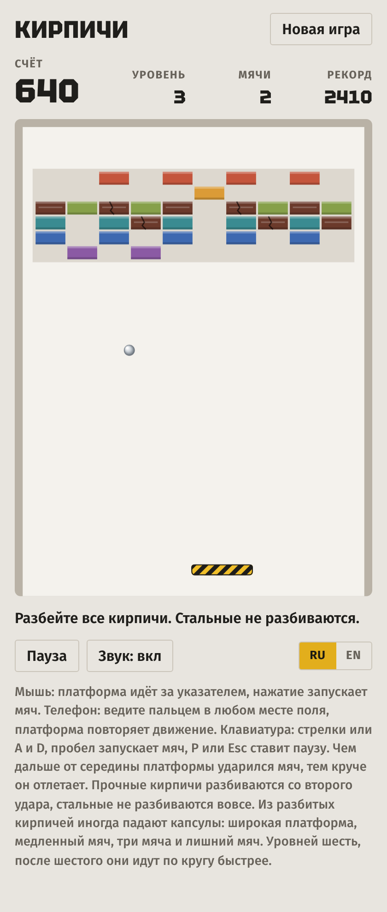
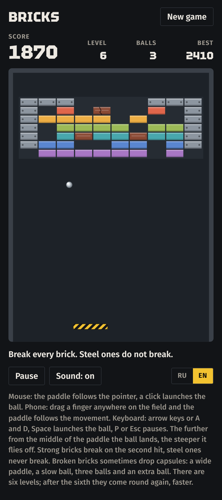

# Кирпичи

[English version](README.md)

Браузерная игра в жанре «Арканоида» на стройке. Удерживайте стальной мяч в игре платформой в жёлто-чёрную полоску и разбейте все кирпичи в стене.

**[Играть в браузере](https://posoxai.github.io/Bricks/)**

  
  

Слева светлая тема с русским интерфейсом, справа тёмная с английским.

## Правила

- У вас три мяча. Мяч, пролетевший мимо платформы, потерян; следующий ждёт на платформе.
- Чем дальше от середины платформы ударился мяч, тем круче он отлетает. Каждый удар о платформу немного ускоряет мяч.
- Уровень пройден, когда разбиты все кирпичи, которые можно разбить.
- После шестого уровня уровни идут по кругу, с каждым кругом быстрее.

## Кирпичи

| Кирпич | Сколько нужно | Очки |
| --- | --- | --- |
| Цветной | один удар | 10 |
| Прочный, тёмный | два удара; после первого трескается | 20 |
| Стальной, с болтами | не разбивается, для прохождения не нужен | — |

За пройденный уровень добавляется 100 очков, умноженные на его номер.

## Капсулы

Из разбитого кирпича иногда падает капсула. Поймайте её платформой.

| Картинка | Что даёт |
| --- | --- |
| Полоска со стрелками | Широкая платформа на 18 секунд |
| Песочные часы | Медленный мяч на 14 секунд |
| Три точки | Каждый мяч в игре делится на три |
| Сердце | Лишний мяч, всего не больше пяти |

На капсулах картинки, а не буквы, поэтому они одинаково понятны на обоих языках.

## Управление

- Мышь: платформа идёт за указателем, щелчок запускает мяч.
- Телефон: ведите пальцем в любом месте поля, платформа повторяет движение, поэтому палец её не закрывает. Нажатие запускает мяч.
- Клавиатура: стрелки или A и D двигают платформу, пробел или стрелка вверх запускает мяч, P или Esc ставит паузу.

Когда вы уходите со вкладки, игра сама встаёт на паузу. Незаконченная игра, рекорд и настройки хранятся в браузере игрока; после перезагрузки возвращается та же стена, мяч ждёт на платформе.

## Язык

Интерфейс на русском и английском. Русский включается сам, если он есть в списке языков браузера, иначе игра открывается на английском. Переключатель RU/EN запоминает выбор.

## Как запустить

Вся игра лежит в одном файле `index.html`. Сборка и зависимости не нужны.

- Локально: откройте `index.html` в браузере.
- По ссылке: игра опубликована через GitHub Pages по адресу https://posoxai.github.io/Bricks/. Каждый коммит в `main` обновляет её автоматически.

Шрифты загружаются с Google Fonts. Без сети игра работает на системных шрифтах.

## Счётчик посещений

Опубликованная страница считает посещения через [GoatCounter](https://www.goatcounter.com/). По словам сервиса, он не ставит cookies и не хранит личных данных. Когда `index.html` открыт с диска, счётчик не работает.

## Авторство

Игру написал Claude, ИИ-ассистент компании Anthropic: логику и физику, шесть уровней, графику на canvas, звук и оформление страницы.

Правила взяты из игр жанра: Breakout (Atari, 1976) и Arkanoid (Taito, 1986). Название, уровни и оформление этой версии свои.

Идея сделать браузерную версию принадлежит posoxAI.

## Лицензия

MIT. Полный текст в файле [LICENSE](LICENSE).
